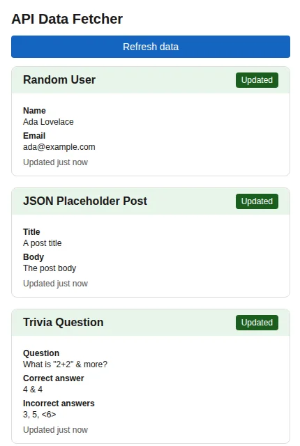
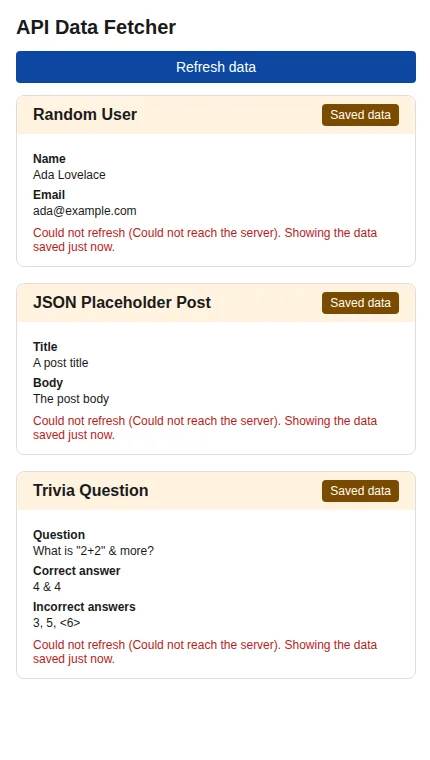

# API Data Fetcher (Chrome extension)

A Manifest V3 extension that shows a random user, a sample post and a trivia question from three public APIs, and **keeps the last data when you are offline or an API fails**.

| Fresh data | After losing the connection |
|---|---|
|  |  |

## Features

- Three cards: [Random User](https://randomuser.me), [JSON Placeholder](https://jsonplaceholder.typicode.com) and [Open Trivia DB](https://opentdb.com).
- **Opens instantly:** it shows the saved data first and only fetches what is out of date. Data is considered fresh for 15 minutes.
- **Works offline, for real:** a failed refresh never erases the last good data. The card says "Saved data", when it was saved and why it could not refresh.
- **Refreshes in the background** every 15 minutes, and has a "Refresh data" button (pressing it again within 10 seconds does nothing, because these free APIs rate-limit).
- Polite with the APIs: the three are fetched in parallel, `HTTP 429/503` are retried at most twice honouring `Retry-After`, and nothing is polled.

## Install

1. Download this repository (**Code > Download ZIP**) and unzip it, or clone it.
2. Open `chrome://extensions` and turn on **Developer mode**.
3. Choose **Load unpacked** and select the folder that contains `manifest.json`.

Needs Chrome 116 or later.

## Permissions

| Permission | Why |
|---|---|
| `storage` | to keep the last good data |
| `alarms` | to refresh every 15 minutes while the browser is open |
| `https://randomuser.me/api/*`, `https://jsonplaceholder.typicode.com/posts/*`, `https://opentdb.com/api.php*` | the three API paths, and nothing else |

## How it works

```
popup.js ──reads──> chrome.storage (the cache) ──draws──> src/render.js      (textContent only)
   │
   └─ asks ─> background.js (service worker) ─> src/refresh.js ─> src/fetcher.js ─> the APIs
                                                    │                  └─ src/apis.js validates every answer
                                                    └─ src/cache.js keeps the LAST GOOD value of each API
```

Every answer is validated by `src/apis.js` before it is saved, and only plain strings ever reach the page.

## What I changed from my first version

I reviewed the first version as if it were someone else's and tried each problem **in a real Chromium**, with a local server standing in for the three APIs (so I could make them fail, answer with hostile text, or rate-limit on demand). Items marked *(code)* I found by reading the code and did not measure.

| First version | Now |
|---|---|
| **On install and every time the popup was opened, it made 3 API requests plus one to `google.com`** (a "connectivity check"); the data took **3.2 to 3.4 seconds** to appear, every time, because of pauses between calls | 3 requests on install and none to `google.com`; opening the popup with fresh data makes **zero** requests and shows the data in under a second |
| **Losing the connection destroyed the saved data:** the last good user (Ada Lovelace) was overwritten with the built-in "fallback" (John Doe). The fallback was never shown, so the popup showed only "Error: No internet connection" and no data, although the README promised "works offline using cached data" | The last good data is kept and shown with the reason and its age |
| **HTML injection:** API text went through `innerHTML`. Injected markup was drawn, a link ("Sign in again") was clickable and an `` triggered a request to a third-party server. (Inline scripts did **not** run: the default security policy of MV3 extensions blocked them) | Everything is drawn with `textContent`; the same hostile text is shown as plain text and triggers no request |
| **An unexpected answer left the popup blank** (0 of 3 cards) | Every answer is validated; the card shows the error and keeps the last good data |
| **The alarm restarted whenever the service worker woke up:** it was recreated at every start, and creating an alarm with an existing name restarts it. After stopping and waking the worker, the next run moved by 6.7 s in my run; if the worker wakes more often than every 15 minutes, the alarm never fires | The alarm is created only if missing: after the same stop and wake, the next run moved by **0.0 s** |
| **Host permission `https://*/*`:** the service worker could reach any site (I confirmed it fetched an unrelated one) | The three API paths. An unrelated site is blocked, the real API is allowed |
| `setInterval` forced a full re-fetch every 60 seconds while the popup was open *(code)* | No polling |
| The trivia API answers **HTTP 200 with `response_code: 5`** when rate-limited, and the code took it for good data; its text came with HTML entities (`&quot;`) *(code)* | `response_code` is checked; the text is requested URL-encoded (`encode=url3986`) and decoded without any HTML |
| The message handler had no error path: if a refresh threw, the popup waited forever *(code)*; any message was accepted *(code)* | It always answers; only our own popup is listened to |
| The README linked a download page that does not exist (`yourusername`) | Fixed |
| No tests | **67 tests**, lint and a CI workflow |

## Tests

```bash
npm install
npm test        # 67 tests
npm run lint
```

They run in Node with a stand-in for the `chrome.*` APIs, and cover the fetching (timeouts, `Retry-After`, errors), the cache (a failure keeps the data, parallel writes, corrupted storage), the refresh rules (fresh data is not fetched, offline, throttling, parallel, one shared refresh for simultaneous calls), the validation of every API answer, the drawing (hostile text stays text, `innerHTML` is never used), the service worker (the alarm is not recreated, messages), and the manifest (least permissions, every fetched URL is covered, icons are real PNGs). I also broke the alarm and the cache on purpose, as in the first version, to check that the tests fail.

**What the repository does not automate:** the checks in a real Chromium (loading the extension, going offline, hostile answers, the alarm after a worker restart) were done by hand with a local test server and are not part of `npm test`.

## Limitations

- Tested in Chromium (Playwright) against a local server, not against the real APIs (no internet in my test environment) and not on other Chrome versions or operating systems.
- Data is kept only on this browser profile (`chrome.storage.local`).
- The three APIs are free public services: their answers and limits can change.
